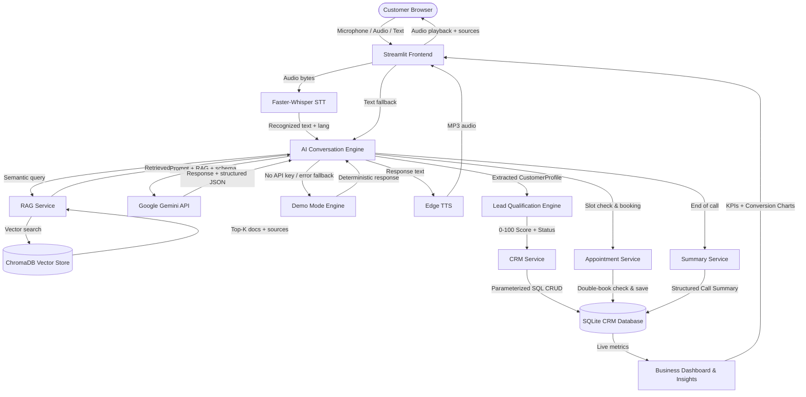

# 🏠 FortivexAI — Autonomous AI Sales Voice Agent

> **DreamHome Realty** | *Your Dream Home, Our Promise*  
> *Built for the FortivexAI Round 3 Advanced AI Project Challenge*

> ⚠️ **DISCLAIMER**: All property listings, company policies, office addresses, prices, and customer records in this repository are **entirely fictional** and created strictly for local technical demonstration. No real estate transactions or legal/financial guarantees are represented.

---

## 📋 Project Overview

An autonomous AI-powered sales voice agent for a fictional Punjab-based real estate consultancy (**DreamHome Realty**). The application handles browser-based voice and text customer inquiries, retrieves accurate property and policy context via RAG (Retrieval-Augmented Generation), qualifies leads with a transparent 100-point rubric, prevents double-booked site visits, persists all data in an embedded SQLite CRM, and generates actionable post-call summaries and business insights.

---

## 🎯 Business Problem

Real estate sales teams lose high-intent prospects due to delayed responses outside office hours, repetitive manual qualification questions, scattered spreadsheet tracking, and scheduling conflicts during property tours.

## 💡 Proposed Solution

A modular, locally runnable AI voice sales assistant that:
- Responds 24/7 via browser microphone capture (Faster-Whisper STT) or text input
- Synthesizes natural English/Hindi audio responses (Edge TTS) with toggleable playback
- Grounds answers in company policies and property inventory using ChromaDB + SentenceTransformers
- Qualifies leads transparently (0–100 points across budget, location, property type, timeline, contact, and purchase interest) without ever falsely qualifying on sentiment alone
- Validates, checks conflicts for, confirms, and books appointments in SQLite (`Asia/Kolkata`)
- Generates structured post-call summaries and computes real-time KPIs from stored records

---

## ✨ Key Features

| Feature | Implementation |
|---|---|
| 🎙️ Browser Voice Input | Native Streamlit `st.audio_input` + audio file upload transcribed by Faster-Whisper (CPU `int8`, English & Hindi auto-detect) |
| 🤖 AI Conversation Engine | Official Google Gen AI Python SDK (`google-genai`) with configurable model (`GEMINI_MODEL`) & structured JSON outputs |
| 🔵 Deterministic Demo Mode | Runs out-of-the-box without an API key (clearly labeled in UI — never pretends live AI is running) |
| 🔍 RAG Knowledge Retrieval | ChromaDB persistent vector store + `all-MiniLM-L6-v2` embeddings with source citation display |
| 📊 Transparent Lead Scoring | Configurable 100-point scoring rubric (`Budget 20 + Location 20 + Property Type 15 + Timeline 20 + Contact 15 + Interest 10`) |
| 👥 Local SQLite CRM | Parameterized CRUD across `customers`, `leads`, `conversations`, `conversation_messages`, `appointments`, `call_summaries` |
| 📅 Conflict-Free Appointments | Business-hours validation (`Asia/Kolkata`), duplicate slot blocking, alternative slot suggestions, and `DH-XXXXXX` codes |
| 📋 Summaries & Insights | Structured call summaries and live conversion/location/sentiment charts computed strictly from SQLite |
| 🔊 Spoken Audio Output | Edge TTS (`en-IN-NeerjaNeural` / `hi-IN-SwaraNeural`) with clean markdown stripping and graceful offline fallback |

---

## 🛠️ Technology Stack

| Component | Technology |
|---|---|
| Programming Language | Python 3.11+ (tested on Python 3.13.3) |
| Frontend | Streamlit |
| Backend | Modular Python services (`backend/`) |
| AI Language Model | Google Gemini API via `google-genai` SDK |
| Speech-to-Text | Faster-Whisper (`base` model on CPU) |
| Text-to-Speech | Edge TTS |
| Vector Database | ChromaDB (persistent local storage) |
| Embeddings | Sentence Transformers (`all-MiniLM-L6-v2`) |
| Relational Database | SQLite (WAL mode, foreign keys) |
| Data Processing & Validation | Pandas, Pydantic v2 |
| Configuration & Testing | `python-dotenv`, Pytest |

---

## 🏗️ System Architecture



See [`docs/architecture.md`](docs/architecture.md) and [`docs/architecture_diagram.mmd`](docs/architecture_diagram.mmd) for detailed component explanations.

---

## 📁 Project Structure

```
fortivex-ai-sales-agent/
├── app.py                        # Main Streamlit entry point
├── config.py                     # Centralized environment configuration
├── requirements.txt              # Pinned, tested package versions
├── .env.example                  # Environment configuration template
├── .gitignore                    # Excludes .env, DBs, chroma_db, logs, temp audio
├── README.md
├── data/
│   ├── properties.csv            # 24 fictional properties (Apartments, Houses, Villas)
│   ├── company_knowledge.txt     # DreamHome Realty company & policy document
│   └── sample_customers.csv      # 5 synthetic customer records
├── scripts/
│   ├── generate_dataset.py       # Generates & validates dataset + initializes DB
│   └── index_knowledge.py        # Idempotent ChromaDB knowledge indexing
├── backend/
│   ├── __init__.py
│   ├── ai_agent.py               # Google Gen AI SDK + Demo Mode + conversational booking
│   ├── conversation.py           # Multi-turn session state & profile extraction
│   ├── rag_service.py            # Chunking, embeddings, ChromaDB semantic retrieval
│   ├── speech_to_text.py         # Faster-Whisper voice transcription
│   ├── text_to_speech.py         # Edge TTS speech synthesis
│   ├── lead_qualification.py     # Configurable 100-point lead scoring + sentiment
│   ├── crm_service.py            # Customer & lead upsert orchestration
│   ├── appointment_service.py    # Slot validation, availability & booking
│   ├── summary_service.py        # Post-conversation structured summary generation
│   ├── database.py               # Parameterized SQLite CRM & metrics queries
│   └── models.py                 # Pydantic v2 validation & schema models
├── frontend/
│   ├── __init__.py
│   ├── dashboard.py              # Page 1: Home Dashboard
│   ├── sales_agent.py            # Page 2: AI Sales Agent (Voice + Text)
│   ├── crm.py                    # Page 3: CRM
│   ├── appointments.py           # Page 4: Appointments
│   ├── knowledge_base.py         # Page 5: Knowledge Base
│   ├── business_insights.py      # Page 6: Business Insights
│   └── settings.py               # Page 7: Settings
├── tests/
│   ├── test_database.py
│   ├── test_lead_qualification.py
│   ├── test_appointments.py
│   ├── test_rag.py
│   └── test_end_to_end.py
└── docs/
    ├── architecture.md
    ├── architecture_diagram.mmd
    ├── deployment.md
    ├── scalability.md
    ├── security.md
    └── cost_estimation.md
```

---

## 🚀 Installation Instructions (Windows)

### 1. Create and Activate a Virtual Environment

```powershell
python -m venv venv
.\venv\Scripts\activate
```

### 2. Install Pinned Dependencies

```powershell
pip install -r requirements.txt
```

### 3. Configure Environment Variables

```powershell
copy .env.example .env
```

- **Demo Mode (No API key needed)**: Leave `GEMINI_API_KEY=` blank and `APP_MODE=demo`.
- **Live Gemini AI Mode**:
  1. Visit [Google AI Studio](https://aistudio.google.com/apikey) and sign in with a Google account.
  2. Click **Create API key**, copy the generated key.
  3. Open `.env` and set:
     ```env
     GEMINI_API_KEY=your_api_key_here
     GEMINI_MODEL=gemini-2.5-flash
     GEMINI_FALLBACK_MODEL=gemini-2.0-flash
     APP_MODE=production
     ```
  4. Never commit `.env` or share your key.

### 4. Generate Dataset & Initialize Database

```powershell
python scripts/generate_dataset.py
```

### 5. Index Knowledge Base into ChromaDB

```powershell
python scripts/index_knowledge.py
```

*(Running either script multiple times is safe and will not create duplicate records or chunks.)*

### 6. Run the Application

```powershell
streamlit run app.py
```

Open **http://localhost:8501** in your browser.

---

## 📊 Dataset Description

- **`data/properties.csv`**: 24 fictional residential properties across Phagwara, Jalandhar, Ludhiana, Nawanshahr, and Adampur covering **Apartments** (1–3 BHK), **Independent Houses** (3–4 BHK), and **Villas** (3–4 BHK) priced from ₹19 Lakh to ₹1.80 Crore.
- **`data/company_knowledge.txt`**: Comprehensive company overview, portfolio summary, amenities, viewing procedures, illustrative bank loan info, FAQs, office hours, appointment policies, refund/cancellation guidelines, and support channels.
- **`data/sample_customers.csv`**: 5 synthetic demonstration customer records.

---

## 🎯 End-to-End Demo Workflow

1. Start the app (`streamlit run app.py`) and open **🎙️ AI Sales Agent**.
2. Use the microphone button (`st.audio_input`) or type:  
   `"I am looking for a 2 BHK apartment in Phagwara within a budget of 50 lakh."`
3. Observe RAG-backed property recommendations (**Sunrise Apartments - 2BHK** at ₹45 Lakh, **LPU Road Premium - 2BHK** at ₹40 Lakh, **Green Valley Homes - 2BHK** at ₹38 Lakh), recognized text, audio playback, and updated **Customer Details** + **Lead Score**.
4. Provide details in follow-up turn:  
   `"My name is Rajesh, phone 9876500000, planning to buy in 3 months"`
5. Schedule a visit conversationally:  
   `"I want to schedule a site visit tomorrow at 10 AM"` → `"Yes, please confirm"`
6. Click **📋 Generate Summary**.
7. Verify persistence across **👥 CRM**, **📅 Appointments**, **🏠 Home Dashboard**, and **📊 Business Insights**.

---

## 🧪 Running Tests

```powershell
pytest tests/ -v
```

All tests use isolated temporary SQLite databases and deterministic fixtures — **no Gemini API key or internet access is required to run the test suite**.

---

## ⚠️ Known Limitations

1. **Turn-Based Voice Interaction**: Browser-based recording + transcription + TTS synthesis (not full-duplex real-time PSTN telephony).
2. **Offline Audio Limitations**: Edge TTS requires internet access; when offline, the app cleanly falls back to text-only responses.
3. **Local Single-User MVP**: SQLite and local ChromaDB are ideal for single-user local demos; production scale requires PostgreSQL, managed vector DB, and async job queues (see [`docs/scalability.md`](docs/scalability.md)).
4. **No User Authentication**: MVP omits login/RBAC (see [`docs/security.md`](docs/security.md)).

---

## 🔮 Future Improvements

- Real-time bidirectional audio streaming via WebSockets / Gemini Live API
- External calendar sync (Google Calendar) & WhatsApp confirmation notifications
- Multi-user authentication, RBAC, and PostgreSQL + managed vector DB migration

---

## 🐙 Preparing Your Public GitHub Repository

This repository is prepared locally without publishing automatically. To publish it when you are ready:

```powershell
git init
git add .
git status   # Confirm .env, data/*.db, chroma_db/, logs/, audio_temp/ are NOT listed
git commit -m "Initial commit: FortivexAI DreamHome Realty AI Sales Voice Agent"
```
Then create an empty repository on GitHub (via github.com or `gh repo create`), and push:
```powershell
git branch -M main
git remote add origin https://github.com/<your-username>/fortivex-ai-sales-agent.git
git push -u origin main
```

---

## 📚 Additional Documentation

- [`docs/architecture.md`](docs/architecture.md)
- [`docs/architecture_diagram.mmd`](docs/architecture_diagram.mmd)
- [`docs/deployment.md`](docs/deployment.md)
- [`docs/scalability.md`](docs/scalability.md)
- [`docs/security.md`](docs/security.md)
- [`docs/cost_estimation.md`](docs/cost_estimation.md)
