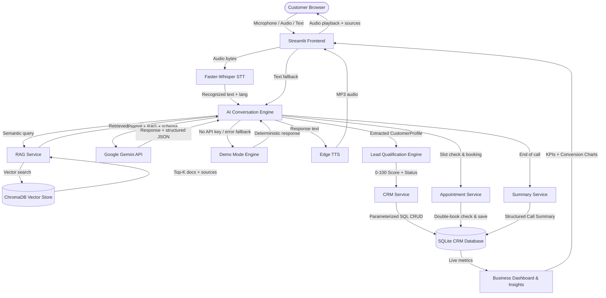

# System Architecture — DreamHome Realty AI Sales Agent

## Overview

This document describes the complete system architecture of the FortivexAI
AI Sales Voice Agent built for DreamHome Realty (fictional demonstration company).

## Architecture Diagram

See [`docs/architecture_diagram.mmd`](architecture_diagram.mmd) for the source Mermaid definition.

## Component Descriptions

### Frontend Layer (`frontend/` + `app.py`)
- **`app.py`**: Entry point, sidebar navigation, theme styling, startup DB/KB initialization.
- **`dashboard.py`**: Home dashboard showing KPIs, lead conversion pipeline chart, recent activity, locations, sentiment, and system health.
- **`sales_agent.py`**: Turn-based voice (`st.audio_input` + file upload) and text conversation UI, retrieved RAG citations, Edge TTS audio playback, live lead score breakdown, conversational & manual appointment booking, and summary generator.
- **`crm.py`**: Searchable/filterable customer directory, lead pipeline, full conversation logs, and linked appointments.
- **`appointments.py`**: Upcoming confirmed appointments with cancellation, full appointment history, and manual booking form.
- **`knowledge_base.py`**: ChromaDB chunk/document stats, semantic search, structured property filters, and reindex triggers.
- **`business_insights.py`**: Real-time conversion analytics, lead score distribution, sentiment trends, and call summaries.
- **`settings.py`**: Safe configuration dashboard (never prints secret API keys) with session model/voice/language selectors.

### Backend Layer (`backend/`)
- **`ai_agent.py`**: Google Gen AI SDK (`google-genai`) integration with structured Pydantic JSON schemas (`ExtractedCustomerInfo`, `GeneratedCallSummary`), fallback model handling, conversational appointment state machine, and deterministic Demo Mode.
- **`conversation.py`**: Multi-turn session management, English/Hindi detection, configurable `CONVERSATION_HISTORY_LIMIT`, and safe profile extraction.
- **`rag_service.py`**: Paragraph-aware text chunking, `all-MiniLM-L6-v2` embeddings, persistent ChromaDB semantic retrieval with source metadata, and CSV structured property filtering.
- **`speech_to_text.py`**: Faster-Whisper CPU (`int8`) transcription with empty/silent WAV validation and English/Hindi language detection.
- **`text_to_speech.py`**: Async Edge TTS MP3 synthesis with markdown cleanup and graceful offline handling.
- **`lead_qualification.py`**: Configurable 100-point scoring rubric, sentiment analysis, and Indian budget parsing/formatting.
- **`crm_service.py`**: Customer upsert (matching existing session customer ID, phone, or email to avoid duplicates) and lead management.
- **`appointment_service.py`**: Timezone-aware (`Asia/Kolkata`) business hours validation, conflict prevention, and `DH-XXXXXX` confirmation generation.
- **`summary_service.py`**: Structured post-call summary creation and SQLite persistence.
- **`database.py`**: Parameterized SQLite queries across 6 normalized tables with WAL mode and foreign key enforcement.
- **`models.py`**: Pydantic v2 validation models.
